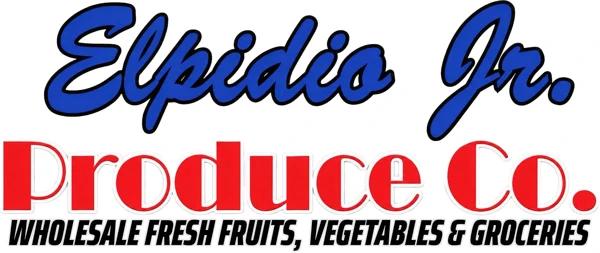
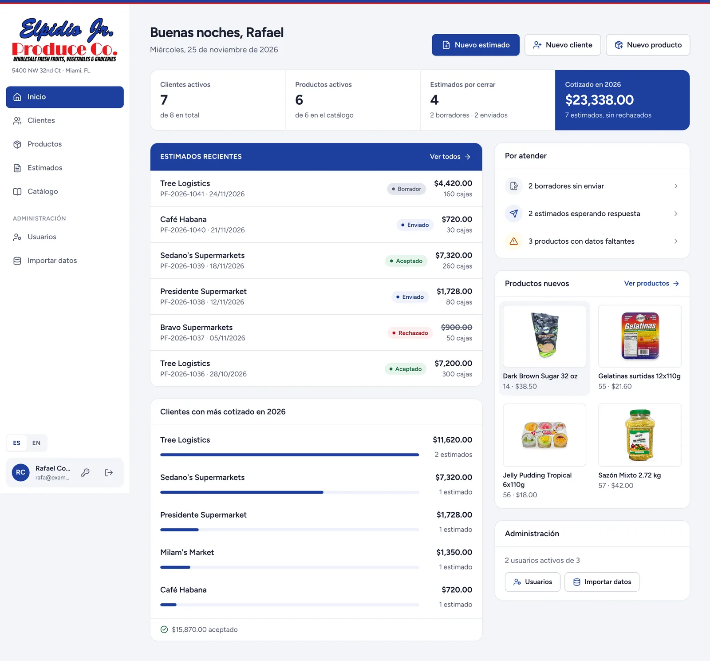

<div align="center">



### NezkaWeb

Clientes, productos y proformas de **Elpidio Jr. Produce Co.**, desde cualquier dispositivo.

[**nezka-web.web.app**](https://nezka-web.web.app)


</div>

<br>

<p align="center">
  
</p>

NezkaWeb es la versión web de [nezka-invoice](https://github.com/rcorzogutierrez/nezka-invoice), la app de escritorio de la empresa. Hace lo mismo que ella, pero con los datos compartidos en la nube: la oficina y el almacén ven la misma información, en la computadora o en el teléfono.

---

## Qué hace

|                      |                                                                                                                                                                            |
| -------------------- | -------------------------------------------------------------------------------------------------------------------------------------------------------------------------- |
| **Inicio**           | Saludo, totales del año, estimados recientes, clientes con más cotizado, productos nuevos y lo que está pendiente (borradores, estimados sin respuesta, datos que faltan). |
| **Clientes**         | Lista con búsqueda y filtros, formulario completo, aviso de nombres repetidos e importación desde QuickBooks (Excel, CSV o IIF) con vista previa.                          |
| **Productos**        | Catálogo con foto, Ref., UPC, tamaño, pack, cajas por pallet y precio por caja y por unidad. Filtro de datos faltantes y exportación a Excel para el proveedor.            |
| **Estimados**        | Proformas con la serie `PF-año-número`, estados (borrador, enviado, aceptado, rechazado) y PDF con el mismo formato de siempre, uno o varios a la vez.                     |
| **Catálogo**         | PDF del catálogo con fotos, con o sin precios, eligiendo qué productos entran.                                                                                             |
| **Usuarios**         | Solo administradores. Alta con contraseña temporal o por correo, roles, activar o desactivar y borrar cuentas.                                                             |
| **Español e inglés** | Se cambia en cualquier momento desde el menú o la pantalla de acceso.                                                                                                      |

**Seguridad.** Se entra con correo y contraseña; no hay registro público. La sesión se cierra sola tras 15 minutos sin uso, con un aviso un minuto antes. Las reglas de Firestore y Storage protegen los datos.

---

## Tecnología

- **Angular 22**: componentes standalone, sin zone.js, signals, Signal Forms y rutas con carga diferida.
- **Firebase** con la librería oficial `firebase` (sin AngularFire): Auth, Firestore, Storage para las fotos y Hosting.
- **Tailwind CSS v4** con los colores de la proforma: azul `#1e3f9e` y rojo `#d7191f`.
- **jsPDF** para la proforma y el catálogo, generados en el navegador.
- Iconos de **Lucide**. Pruebas con **Vitest**, **ESLint** y **Prettier**.

---

## Trabajar en local

> Requisitos: Node 22.12 o superior, y Java 21 para los emuladores de Firebase.

```bash
npm install
npm run emulators   # Auth, Firestore y Storage locales (en otra terminal)
npm start           # http://localhost:4200
```

En desarrollo la app usa los **emuladores** con el proyecto `demo-nezka`, así que nada de lo que hagas en local toca los datos reales. La consola de los emuladores está en http://localhost:4000.

| Comando              | Qué hace                                                 |
| -------------------- | -------------------------------------------------------- |
| `npm test`           | Pruebas unitarias (modo observación)                     |
| `npm run test:ci`    | Pruebas una vez, con cobertura en `coverage/`            |
| `npm run test:rules` | Pruebas de las reglas de Firestore y Storage             |
| `npm run lint`       | ESLint con reglas de Angular y accesibilidad             |
| `npm run format`     | Prettier (ordena también las clases de Tailwind)         |
| `npm run check`      | Todo lo anterior y el build, igual que en GitHub Actions |

---

## Publicar

Cada **merge a `main`** publica la app, junto con las reglas de Firestore y Storage, en Firebase Hosting mediante el flujo `Deploy` de GitHub Actions. Cada pull request pasa antes por el flujo `CI`.

<details>
<summary><b>Configuración inicial del proyecto Firebase</b> (una sola vez)</summary>

<br>

En el proyecto `nezka-web` (plan Blaze):

1. **Authentication › Método de acceso**: activa Correo electrónico/contraseña.
2. **Firestore Database**: crea la base de datos.
3. **Storage**: pulsa «Comenzar» para crear el bucket `nezka-web.firebasestorage.app`, donde van las fotos.
4. En Google Cloud (IAM › Cuentas de servicio) crea una cuenta con los roles Firebase Hosting Admin, Firebase Rules Admin, Cloud Storage for Firebase Admin, API Keys Viewer, Service Account User y Service Usage Consumer, y descarga una clave JSON.
5. En GitHub, **Settings › Secrets and variables › Actions**, crea el secreto `FIREBASE_SERVICE_ACCOUNT` con ese JSON. Luego borra el archivo.

Sin el secreto, el deploy se omite. También se puede publicar a mano con `npx firebase login` y `npm run deploy`.

Tras el primer deploy, abre el sitio y usa **Crea la cuenta de administrador** en la pantalla de acceso.

La configuración web de Firebase (`src/environments/environment.ts`) no es secreta: los datos los protegen Auth y las reglas.

</details>

---

## Estructura

```
src/app/
├─ core/        Servicios y lógica: auth, sesión, Firebase, clientes, productos,
│               estimados, usuarios, inicio, PDF, Excel e idiomas
├─ features/    Pantallas: inicio, clientes, productos, estimados, catálogo,
│               usuarios y acceso
├─ layout/      Marco de la app con el menú lateral
└─ shared/ui/   Piezas de interfaz reutilizables
firestore-tests/   Pruebas de las reglas de seguridad
```

Las decisiones visuales están en [`DESIGN.md`](DESIGN.md) y los datos del producto en [`PRODUCT.md`](PRODUCT.md).

<br>

<p align="center"><sub>Elpidio Jr. Produce Co. · 5400 NW 32nd Ct, Miami, FL · Wholesale Fresh Fruits, Vegetables &amp; Groceries</sub></p>
